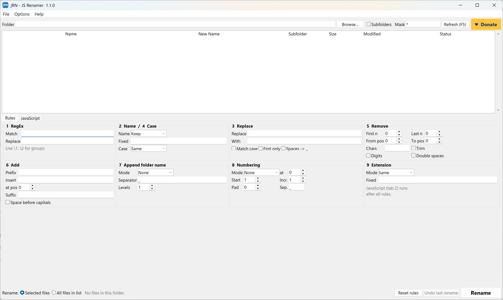

# jRN - JS Renamer - JavaScript Renamer

**Free, portable bulk file renamer for Windows, with JavaScript renaming.**

Made by **Stefan Karlsson** · *Gazeomatic*

[](https://github.com/Siba79/jRN/releases/latest)
[](https://paypal.me/gazeomatic)




## Download & start
1. Download `jRN_v<version>_Windows_x64_portable.zip` from [Releases](https://github.com/Siba79/jRN/releases).
2. Unzip it anywhere, for example `D:\Programs\jRN`.
3. Run `jRN.exe`. There's no installer.

Or install it with winget:  `winget install Gazeomatic.jRN`

**Portable:** jRN keeps its settings, scripts and undo log in a `jRN_data` folder next to `jRN.exe`.
Nothing is copied to Windows. To remove jRN, delete the folder.
The only optional system change is the Explorer menu (see below), and you can remove it again from the app.

## Features
- **Rules:** RegEx, Name, Replace, Case, Remove, Add, Append folder name, Numbering, Extension.
- **JavaScript renaming** in the same style as Bulk Rename Utility: `fileProperty()`, `filePropertyNum()`, `counter`, `newName`, `object("folder")`, `padNum()` and more.
- Reads any Windows file property: image width/height, date taken, camera, music tags and more.
- Live preview. Red rows show problems such as duplicate names, files that already exist or invalid characters.
- Safe, all-or-nothing renaming, and **Undo** that works even after a restart.
- **Options > Show 'Open in jRN' in Explorer right-click menu** (optional, on/off). On Windows 11 it's under *Show more options*.

## Example script
```js
// HDR_<folder>_<longest side>_001.jpg
var w = filePropertyNum('System.Image.HorizontalSize');
var h = filePropertyNum('System.Image.VerticalSize');
newName = "HDR_" + folderName + "_" + Math.max(w, h) + "_" + padNum(counter, 3);
```

## Support
jRN is freeware. If it saves you time, a donation is much appreciated:
**[paypal.me/gazeomatic](https://paypal.me/gazeomatic)**

See `LICENSE.txt` for the terms.

## Version history

### 1.1.0
- Freeware release: compiled, portable build (settings stay in `jRN_data` next to `jRN.exe`)
- PayPal donate button and a new About window
- Settings from earlier versions are imported automatically

### 1.0.2
- Sharp jRN icon in the title bar and taskbar
- The window always fits on the screen

### 1.0.1
- Release zips with version numbers, and Windows file details in jRN.exe

### 1.0.0
- First version: rename rules, JavaScript renaming, file properties, live preview, undo
  and the Explorer right-click menu
